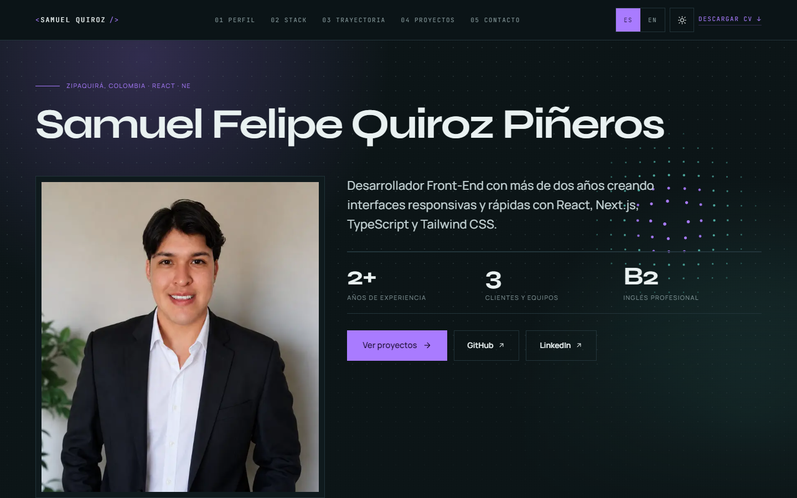

<div align="center">

# Portafolio · Samuel Quiroz

**Front-End Developer** · Zipaquirá, Colombia

Portafolio personal construido con Next.js 15, TypeScript y Tailwind CSS v4.
Lo diseñé y lo construí yo, sin plantillas.

### [▶ Verlo en vivo · samuel-quiroz.vercel.app](https://samuel-quiroz.vercel.app)




</div>

## Qué tiene

- **Tema claro y oscuro.** Al cambiar de tema, el nuevo se expande en círculo desde el botón (View Transitions API).
- **Dos idiomas, español e inglés.** Todos los textos viven en un solo diccionario tipado.
- **Fondo interactivo.** Una cuadrícula de puntos en canvas que se enciende y se aparta alrededor del cursor. Solo dibuja mientras algo cambia: en reposo no gasta ni un fotograma.
- **Animaciones propias, sin librerías.**
  - Tarjetas con inclinación 3D y reflejo que siguen al cursor.
  - Cinta infinita con todo el stack.
  - El rol del hero se escribe y se borra como en una terminal, y las cifras se «descifran».
  - Los títulos suben palabra a palabra y las líneas de sección se dibujan solas.
  - Barra de lectura ligada al scroll y cabecera que se aparta al bajar.
- **Tipografía.** Syne en los títulos, Manrope en el texto y JetBrains Mono en las etiquetas.
- **Rendimiento.** Solo se anima `transform`, `opacity` y `clip-path`, y la página es estática. Lighthouse da 100 en rendimiento, accesibilidad, buenas prácticas y SEO en escritorio (96 de rendimiento en móvil).
- **Accesibilidad.** Respeta `prefers-reduced-motion`, los lectores de pantalla leen siempre el texto real (nunca los caracteres de un efecto) y, si el JavaScript no llega a cargar, la página se muestra completa igualmente.
- **Del diseño al código.** En [`Design/`](Design/) están las maquetas de escritorio, tablet y móvil, junto con las tres propuestas descartadas.

## Estructura

```
Portafolio/
├── Design/              Maquetas (escritorio, tablet, móvil) y propuestas descartadas
└── web/                 Aplicación Next.js
    ├── public/          Foto, capturas de proyectos y CV en PDF
    └── src/
        ├── app/         Layout, página y estilos globales (tokens de color y animaciones)
        ├── components/  Secciones de la página
        │   └── motion/  Reveal, Scramble, Typewriter, DotField y MotionLayer: el sistema de animación
        └── lib/         Contenido bilingüe, datos del sitio y hooks de movimiento
```

## Ejecutar en local

```bash
cd web
npm install
npm run dev        # http://localhost:3000
```

Otros comandos: `npm run build`, `npm start` y `npm run typecheck`.

## Cómo se trabaja este repositorio

Cada cambio se hace en su propia rama y entra a `main` con un merge `--no-ff`. Así el historial muestra qué se hizo y por qué:

| Prefijo  | Uso                                     |
| -------- | --------------------------------------- |
| `feat/`  | Funcionalidad o cambio visible          |
| `fix/`   | Correcciones, incluidas las de seguridad |
| `docs/`  | Documentación                           |
| `chore/` | Mantenimiento                           |

Los mensajes siguen [Conventional Commits](https://www.conventionalcommits.org/es/).
Para verlo: `git log --oneline --graph`.

## Contacto

[LinkedIn](https://www.linkedin.com/in/samuel-felipe-quiroz-pi%C3%B1eros-3a5327323/) · [GitHub](https://github.com/Theace07) · sfqp2003@gmail.com
